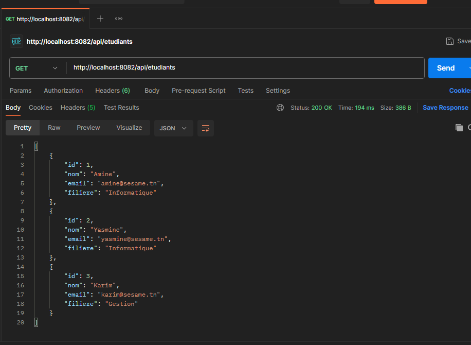
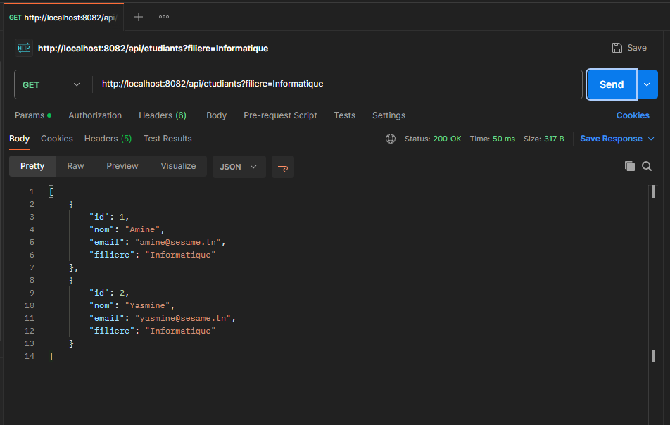
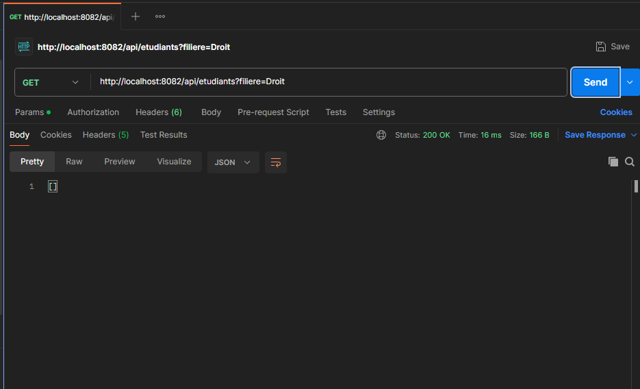
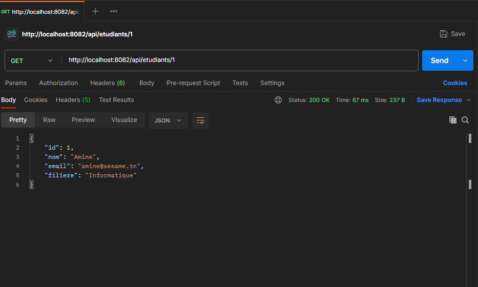
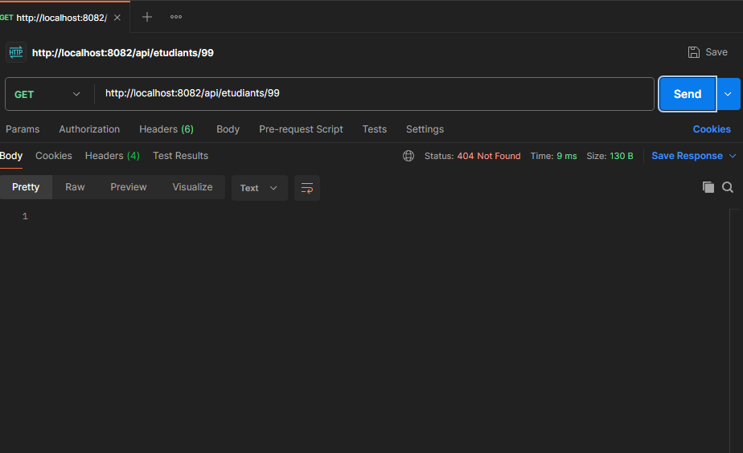
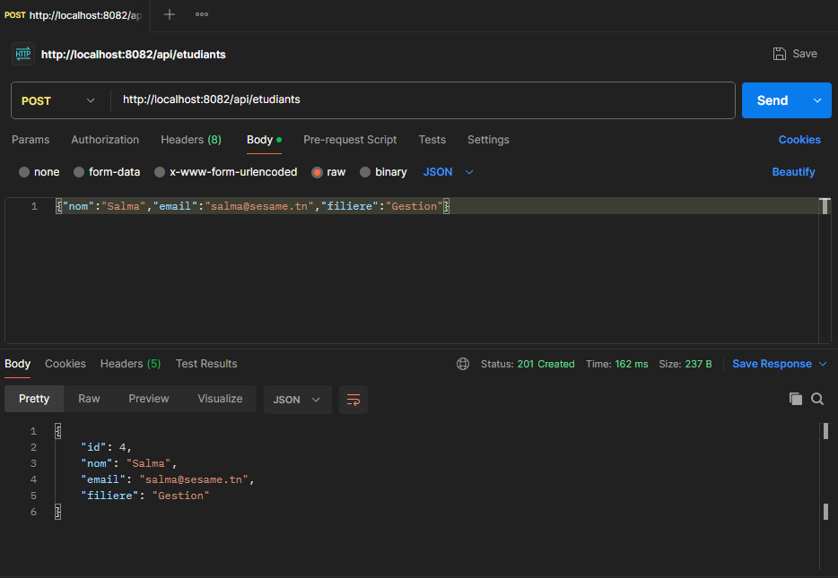
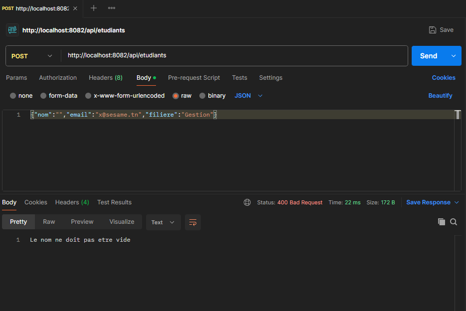
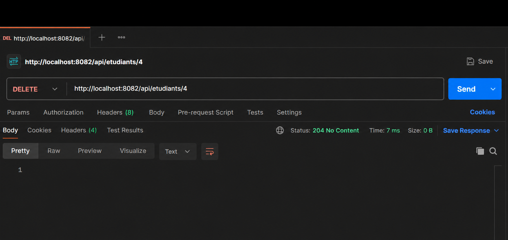

# TP2 – Application en couches : gestion d'étudiants

**Nom :** Rym Razgui  


## Description

Application Spring Boot organisée en trois couches (Controller, Service, Repository) qui gère des étudiants à travers une API REST. Les dépendances sont injectées par le constructeur. Les étudiants sont gardés en mémoire dans une liste Java : ils disparaissent à l'arrêt de l'application.

## Lancement

```bash
./mvnw spring-boot:run
```

L'application démarre sur `http://localhost:8082`.

## Architecture en trois couches

```
Client (Postman)
      │  requête HTTP
      ▼
┌──────────────────────┐
│  EtudiantController  │  Couche présentation
└──────────┬───────────┘
           ▼
┌──────────────────────┐
│   EtudiantService    │  Couche métier
└──────────┬───────────┘
           ▼
┌──────────────────────┐
│  EtudiantRepository  │  Couche d'accès aux données
└──────────────────────┘
```

| Couche | Classe | Rôle |
|---|---|---|
| Présentation | `EtudiantController` | Reçoit les requêtes HTTP, appelle le service et renvoie la réponse avec le bon code (200, 201, 204, 400, 404). |
| Métier | `EtudiantService` | Applique les règles de gestion (nom et email obligatoires) et appelle le repository. |
| Accès aux données | `EtudiantRepository` | Garde les étudiants en mémoire (liste Java) : lecture, recherche par filière, ajout, suppression. |

## Routes

| Opération | Verbe et URL | Corps | Succès | Erreur |
|---|---|---|---|---|
| Lister / rechercher | `GET /api/etudiants` ou `GET /api/etudiants?filiere=Informatique` | aucun | 200 + la liste (filtrée si `filiere`) | — |
| Lire | `GET /api/etudiants/{id}` | aucun | 200 + l'étudiant | 404 |
| Créer | `POST /api/etudiants` | JSON de l'étudiant | 201 + l'étudiant créé | 400 si nom ou email vide |
| Supprimer | `DELETE /api/etudiants/{id}` | aucun | 204 sans contenu | 404 |

## Captures d'écran

**Console au démarrage – beans `etudiantController`, `etudiantService`, `etudiantRepository`**


**Test 1 – `GET /api/etudiants` → 200 + 3 étudiants**


**Test 2 – `GET /api/etudiants?filiere=Informatique` → 200 + 2 étudiants**


**Test 3 – `GET /api/etudiants?filiere=Droit` → 200 + liste vide**


**Test 4 – `GET /api/etudiants/1` → 200 + l'étudiant 1**


**Test 5 – `GET /api/etudiants/99` → 404**


**Test 6 – `POST /api/etudiants` (Salma) → 201 + id = 4**


**Test 7 – `POST /api/etudiants` (nom vide) → 400**


**Test 8 – `DELETE /api/etudiants/4` → 204**


## Pourquoi injecter les dépendances par le constructeur ?

- Les dépendances sont explicites : en lisant le constructeur, on voit tout de suite ce dont la classe a besoin.
- Les champs peuvent être `final` : la dépendance est fixée une fois pour toutes et ne peut pas être modifiée par erreur.
- La classe ne peut pas être créée sans ses dépendances, donc pas de `NullPointerException` à cause d'un objet non initialisé.
- Les tests sont plus simples : on peut créer la classe avec `new` en lui passant un faux repository ou service.
- Spring recommande cette méthode, contrairement à `@Autowired` sur un attribut, et les dépendances circulaires apparaissent dès le démarrage.
